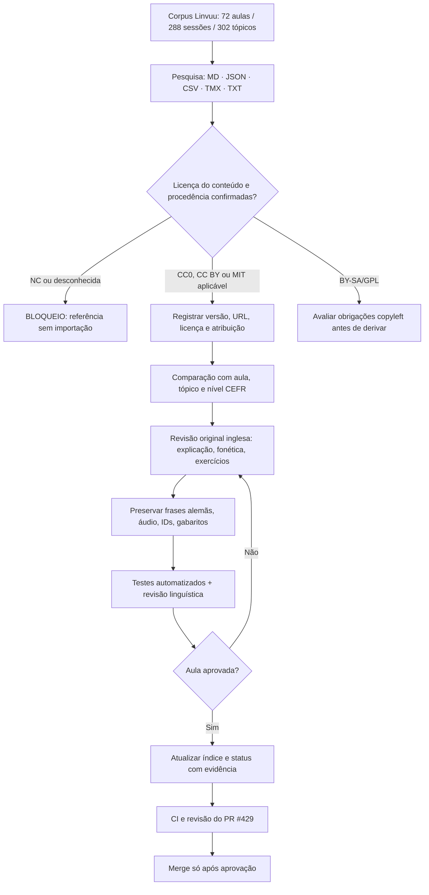

# Grafo operacional — alemão explicado em inglês

[Início](00-INICIO.md) · [Matriz de 72 aulas](02-MATRIZ.md) · [Catálogo anterior](01-FONTES.md) · [Critérios](03-GATES.md) · [Registro](04-REGISTRO.md)

## Fontes pesquisadas — trilha de investigação

| ID | Fonte | Formato e escala | Licença do conteúdo | Decisão |
|---|---|---|---|---|
| DF | https://github.com/DeutschFokus/german-learning-toolkit | A1 grammar MD, vocabulary JSON/CSV, DE–EN | MIT no repositório | **Candidata**: inspecionar cada asset antes de importar |
| UT | https://coerll.utexas.edu/dib/ | Livro didático alemão com explicações inglesas, PDF | CC BY indicado pelo catálogo COERLL | **Candidata**: confirmar permissão por mídia |
| EV | https://everflip.app/dataset | Flashcards multilíngues, CSV/data package | CC BY 4.0 para dados | **Candidata**: DE–EN e qualidade |
| WD | https://github.com/enz/german-wordlist | Wordlist TXT | CC0 | **Candidata** auxiliar, sem níveis confiáveis |
| TA | https://live.european-language-grid.eu/catalogue/corpus/3189 | 385.409 unidades DE–EN, TMX | CC BY 2.0 no catálogo dessa versão | **Candidata** para frases, metadados e validação; verificar licença por frase e procedência |
| PC | https://live.european-language-grid.eu/catalogue/corpus/4728 | 82.149.652 unidades DE–EN, TMX | CC0 no registro ELG | **Triagem jurídica e qualitativa aprofundada**; captura da web, risco de direitos subjacentes, dados pessoais, não importar automaticamente |
| GS | https://github.com/salmanmohebi/german-study-kit | 70 MD gramaticais A1–B2 (informação de busca a revalidar) | Não verificada | **Somente estrutura / referência**, sem copiar |
| TAR | https://github.com/bahman-farhadian/tartarus | JSON vocabulary/sentences por nível até C2 | Conteúdo não confirmado | **Bloqueio** até verificar direitos |
| LEX | https://github.com/massimomazzariol/Lexicon | Conteúdo JSON versionado, DE/EN/IT, A1–C2 | Não verificada | **Bloqueio**, analisar dados, licença e origem |
| DK | https://github.com/hasharmujahid/deutsch-karten | 5.684 palavras em JSON e CSV A1–C2 | Licença de datasets/origens não verificada | **Bloqueio**, revisar fontes derivadas |
| WU | https://huggingface.co/datasets/cstr/grundwortschatz-voc-de | 10.450 lemas, traduções/IPA/exemplos, banco estruturado | GPL-3.0 no dataset (redist. de BY-SA) | **Não misturar** com livro/curso proprietários; orientação jurídica |
| MER | https://www.merlin-platform.eu/ | 2.286 textos de aprendizes, TXT + anotações | CC BY-SA 4.0 | Pesquisa de erros; derivações BY-SA exigem planejamento |
| MLL | https://github.com/MeloLingua/melolingua-language-stories-dataset | 118 histórias A1–B2, JSON/CSV, DE–EN e outras línguas | **CC BY-NC 4.0** para dados | **EXCLUIR** importação comercial, mesmo com código MIT |
| LV | https://webserver.cl.uni-heidelberg.de/statnlpgroup/librivoxdeen/ | 50 mil pares com áudio, transcrição e tradução | **CC BY-NC-SA 4.0** | **EXCLUIR** importação comercial |
| LL | https://github.com/LibreLingoCommunity/LibreLingo-DE-from-EN | Curso DE–EN estruturado | **CC BY-NC-SA 4.0** | **EXCLUIR** importação comercial |
| LE | https://github.com/eyalev/language-learning-resources | ~800 links multilíngues JSON/CSV | CC BY 4.0 no catálogo | **Candidata** para descoberta, não licença sobre materiais apontados |
| DP | https://huggingface.co/datasets/DEplain/DEplain-web-sent | 1.846 pares alemão padrão/simplificado | Licenças por documento; verificar termos | Pesquisa de legibilidade, não DE–EN |

## Agenda de comparação editorial

| Tema Linvuu | Fontes | Comparar | Estado |
|---|---|---|---|
| Aula 1: alfabeto e fonética para anglófonos | DF, UT | IPA, analogias do inglês e tradução das glosas | Sessão 001: 20 alterações pontuais; revisão restante pendente |
| Artigos, gênero, substantivos | DF, UT, WD, DK | articulação der/die/das, plural e exemplos contextualizados | Não iniciado |
| Ordem V2, presente, perguntas | DF, UT, GS | explicação EN, prática comunicativa | Não iniciado |
| Acusativo e dativo | DF, UT, GS | casos, pronomes e gabaritos | Não iniciado |
| Perfekt e Präteritum | UT, GS | contraste temporal com inglês | Não iniciado |
| Subordinadas, conectores e Konjunktiv | GS, MER | estrutura e diagnóstico de erros, sem copiar conteúdo restrito | Não iniciado |
| Leituras A1–B2 | UT, MER, DP | progressão CEFR, extensão, compreensão e clareza | Não iniciado |
| Vocabulário por nível | EV, TA, WD, DK, LEX | significado, gênero, plural, frequência e licença | Não iniciado |

## Regras de execução e retomada

1. Abrir este arquivo e a [matriz](02-MATRIZ.md); encontrar nota da aula e sessão correspondente.
2. Registrar por item: `source_id, source_url, commit/version, author, content_license, upstream_license, item_id, cefr, lesson_id, action, QA`.
3. Nunca tratar licença de software como licença dos conteúdos. Obras NC não entram; materiais BY-SA e GPL não podem ser inseridos sem estratégia de licenciamento compatível.
4. Revisar inglês próprio, explicações, fonética, `pt`/campos legados, exercícios e gabaritos; preservar conteúdos originais alemães e áudio.
5. Executar `node scripts/pesquisar-mapa-de-en.mjs "Konjunktiv"`, `node scripts/testar-mapa-de-en.mjs`, `node scripts/auditar-de-en.mjs --limit=100`, TypeScript, testes SEO e CI em checkout.
6. **Não aprovar todas as 72 aulas por existirem arquivos; não fazer merge, deploy, sitemap ou alterar português até gates completos.**

## Checagem de completude deste inventário

Esta é uma expansão concreta do levantamento, mas **não é ainda a auditoria arquivo a arquivo dos datasets externos**, nem uma validação jurídica final. Algumas fontes estão explicitamente bloqueadas.
