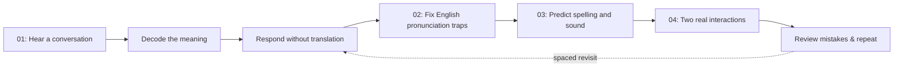

# Lesson 01 — First Steps in German

[Obsidian map](00-INICIO.md) · [Lesson note](aulas/L01.md) · [Approval gates](03-GATES.md) · [PR #429](https://github.com/FelipeVRosa/Linvuu/pull/429)

**Editorial principle:** this is a German course written for English-speaking learners, not a translation of the Portuguese textbook. The objective is communicative success, supported by sound-to-spelling explanations specific to English.

## Learning outcome and assessment

At the end of four sessions the learner can (1) understand and reproduce a short informal meeting, (2) pronounce and recognise common traps in German W, V, J, Z, Ö and Ü, (3) decode ei / ie / au / eu / sch / ch in common words, and (4) choose informal and formal greetings appropriately in a short interaction. These are beginning-of-A1/level-zero outcomes, not a CEFR certification.

| Session | Story / task | Evidence of learning | File |
|---|---|---|---|
| 01 · Your First German Conversation | Listen, guess, reveal the translation, respond | Nine assessed exercises + oral role switch | [001](https://github.com/FelipeVRosa/Linvuu/blob/de-en/entrega-rascunho/content/idiomas/de/en/dia-001.json) |
| 02 · German Sounds English Speakers Misread | Contrast German V/W, J/Z and front rounded vowels | Nine assessed exercises + mouth-position drill | [002](https://github.com/FelipeVRosa/Linvuu/blob/de-en/entrega-rascunho/content/idiomas/de/en/dia-002.json) |
| 03 · Read German with Confidence | Predict and then listen: Wein/Wien, sch, sp, two ch sounds | Eleven assessed exercises + novel-word decoding | [003](https://github.com/FelipeVRosa/Linvuu/blob/de-en/entrega-rascunho/content/idiomas/de/en/dia-003.json) |
| 04 · Your First Real-World Interaction | Informal exchange, comprehension at café, formal greeting | Fifteen assessed exercises + three repeats + two scenarios | [004](https://github.com/FelipeVRosa/Linvuu/blob/de-en/entrega-rascunho/content/idiomas/de/en/dia-004.json) |

**Delivery scope:** 4 × 30-minute authored sessions, 44 assessed exercises, three repetition supplements, two dialogues and a three-question reading passage. Timings are lesson design targets, not measured learner completion times.

## Technical contract already checked

- Unique graded exercise identifiers `de-001-e01` through `de-001-e44`, plus `r01` through `r03`.
- Each multiple-choice/fill-gap answer appears among available options.
- All sentence-ordering answers use exactly their input tokens (punctuation ignored as in the application).
- The two dialogue blocks use `pt` as the English translation field because `src/components/Sessao.tsx` renders `l.pt`. This legacy key name is deliberately preserved for the English content.
- Three grammar topics (`a1-s3-1`, `a1-s3-2`, `a1-s4-3`) were aligned with the rebuilt lesson.
- `node scripts/testar-l01-de-en.mjs` is the repeatable structural test; CI workflow: `.github/workflows/de-en-l01.yml`.
- The build-only preview switch `VITE_DE_EN_L01_PREVIEW=1` in `src/lib/content.ts` makes only L01 resolve to the English JSON in an **explicitly configured staging/development build**. By default, it remains off. Run locally with `VITE_DE_EN_L01_PREVIEW=1 npm run dev` and open the English-prefixed `/curso/de/dia/1` route.

## Pedagogical source checks (not copied)

- Goethe-Institut *Deutsch Training Online A1*, chapter 1 summary: greetings, asking after someone's well-being, *dir/Ihnen*, *Gute Nacht* at bedtime — https://lernplattform.goethe.de/pluginfile.php/1504446/mod_folder/content/0/DT_Training_Online_A1_RM-GR_K01-18_de.pdf.
- University of Texas COERLL *Deutsch im Blick*, chapter 3 pronunciation: contrast German W /v/, German V usually /f/ with exceptions, German Z /ts/ — https://coerll.utexas.edu/dib/pho.php?k=3.
- The German dialogues, explanations, tables, tasks and feedback in this lesson are newly authored for Linvuu. No text, audio or images were transplanted from these references.

## Unresolved before public release

1. GitHub Actions must report a successful Node structural test and TypeScript check. The workflow has been committed, but no successful run was confirmed here.
2. Browser and mobile render must be tested on the English locale, including display of dialogue translations, lesson navigation and keyboard operation.
3. Verify actual audio playback for every new or reused audio cue; a textual audio key is not proof the file exists.
4. Review pronunciation by a qualified German speaker and perform final English copyediting.
5. Decide whether the duration matches observed learner use. Test on at least one learner rather than treating 120 minutes as a guarantee.
6. Obtain permission to activate L01 in `content/indice.en.json`, then deploy and verify. The current `de.aulas` is intentionally empty; the PR must not be merged solely based on this document.

This note describes the finished **editorial draft** of Lesson 1, not a verified production release.
